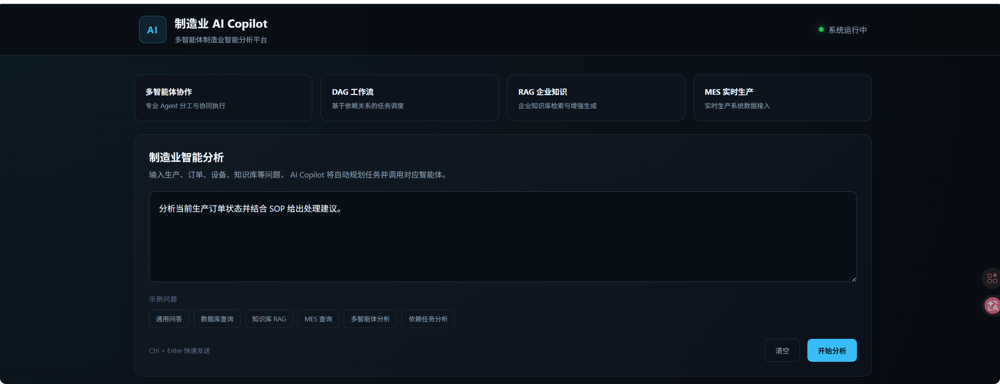
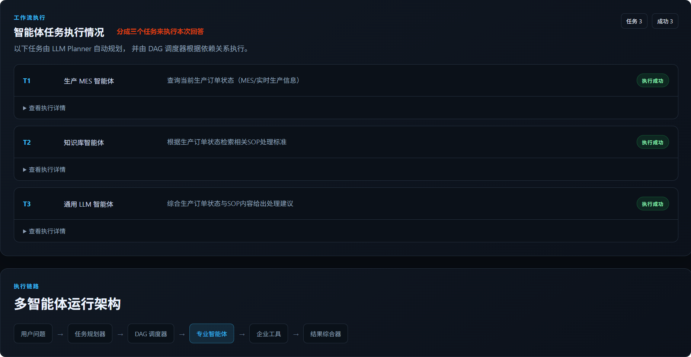
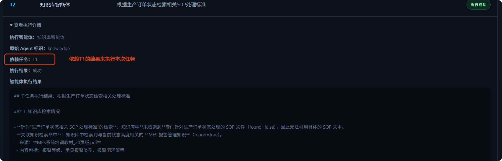
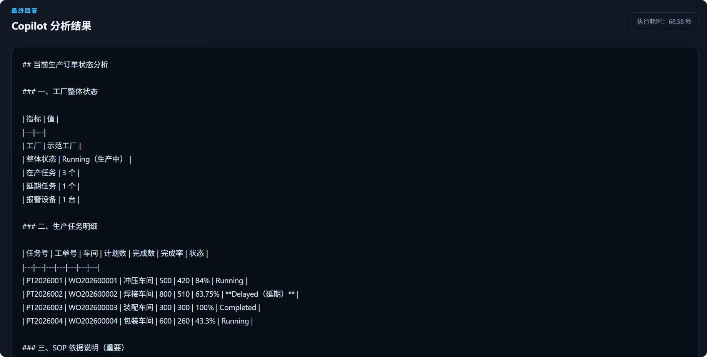

# Manufacturing AI Copilot

一个面向制造业场景的 **Multi-Agent AI Copilot** 项目。

项目基于 LLM、Agent Runtime、Tool Calling、RAG、MES、Database、DAG Workflow 和 FastAPI 构建，重点展示大模型应用工程、智能体系统设计以及 Python Backend 能力。

它不是一个简单的聊天机器人，而是一个能够：

* 自动理解用户问题
* 规划多个子任务
* 将任务分配给不同专业 Agent
* 根据依赖关系调度任务
* 并行执行独立任务
* 调用数据库、知识库和 MES 工具
* 隔离局部失败
* 综合多个 Agent 结果

的制造业 AI 智能体系统。

---

## 1. Overview

在真实制造业场景中，一个业务问题往往需要同时访问多个系统。

例如：

> 分析当前订单和生产状态，并给出风险建议。

可能同时需要：

1. 查询销售订单与生产工单；
2. 获取 MES 实时生产状态；
3. 查询设备报警；
4. 检索相关 SOP；
5. 综合多个数据源形成最终建议。

如果全部能力都放入一个万能 Agent，会带来：

* Tool 数量快速膨胀；
* Agent 职责边界模糊；
* Prompt 越来越复杂；
* 企业数据访问权限难以隔离；
* 复杂任务难以并行；
* 局部故障容易影响整个流程。

因此，本项目采用：

```text
LLM Task Planning
+
Multi-Agent
+
DAG Task Scheduling
+
Agent Runtime
+
Tool Calling
```

的整体设计。

---

# 2. Core Features

项目当前主要能力包括：

* **Multi-Agent Architecture**
* **LLM Task Planning**
* **Agent Runtime**
* **Tool Calling**
* **DAG Dependency Scheduling**
* **Parallel Task Execution**
* **Database Agent**
* **Knowledge / RAG Agent**
* **MES / Production Agent**
* **Failure Isolation**
* **FAILED / SKIPPED Failure Propagation**
* **Prompt Hardening**
* **FastAPI Backend**
* **Manufacturing Web Dashboard**
* **Task / Agent Execution Visualization**

---

# 3. Architecture

整体执行流程：

```text
Browser
   ↓
FastAPI
   ↓
ManufacturingWorkflow
   ↓
LLMTaskPlanner
   ↓
TaskPlan
   ↓
TaskDispatcher
   ↓
AgentRegistry
   ↓
Agents
 ├── LLMAgent
 ├── DatabaseAgent
 ├── KnowledgeAgent
 └── ProductionAgent
   ↓
AgentRuntime
   ↓
Tool Calling
   ↓
Enterprise Tools
   ↓
TaskResult
   ↓
Synthesizer
   ↓
Final Answer
   ↓
Web Dashboard
```

主 Workflow 使用 LangGraph 管理：

```text
START
  ↓
plan
  ↓
dispatch
  ↓
synthesize
  ↓
END
```

其中：

```text
LangGraph
=
Workflow State Machine
```

而：

```text
TaskDispatcher
=
SubTask DAG Scheduler
```

两者承担不同职责。

---

# 4. Why LangGraph + TaskDispatcher?

本项目没有将每一个动态 SubTask 都直接转换为 LangGraph Node。

LangGraph 只管理稳定的顶层 Workflow：

```text
plan
dispatch
synthesize
```

LLM Planner 动态生成的子任务则由 `TaskDispatcher` 管理。

这样设计主要因为：

* SubTask 数量由 LLM 动态决定；
* Task dependency 也是运行时生成；
* Dispatcher 更适合处理动态 DAG；
* LangGraph 保持稳定、清晰的顶层状态机；
* 避免动态修改 Graph 结构带来的复杂度。

---

# 5. Multi-Agent Design

当前系统包含四个核心 Agent。

## LLMAgent

负责：

* 通用问题回答；
* 无企业系统依赖的问题；
* 最终结果综合使用的基础 LLM 能力。

LLMAgent 不拥有：

```text
Database Tool
Knowledge Tool
MES Tool
```

因此不会直接访问企业业务系统。

---

## DatabaseAgent

负责：

* 销售订单查询；
* 生产工单查询；
* 企业结构化业务数据分析。

工具能力只来源于 Database ToolSet。

典型链路：

```text
DatabaseAgent
↓
AgentRuntime
↓
Database Tool
↓
SQLite
```

---

## KnowledgeAgent

负责：

* 企业知识检索；
* 制造工艺资料；
* SOP；
* 设备知识；
* MES 培训资料；
* 机械制造知识。

典型链路：

```text
KnowledgeAgent
↓
Knowledge Tool
↓
Embedding
↓
Chroma
↓
Retrieved Context
↓
LLM Answer
```

KnowledgeAgent 要求：

> 必须先查询知识库，不能把模型记忆伪装成企业知识。

当知识库没有可靠依据时，会明确返回未检索到相关内容。

---

## ProductionAgent

负责：

* 实时生产状态；
* 当前生产任务；
* 设备状态；
* 设备报警；
* MES 数据。

典型链路：

```text
ProductionAgent
↓
MES Tool
↓
HTTP
↓
MES Service
```

实时生产问题必须调用 MES Tool。

如果 MES 不可用，Agent 不允许根据模型记忆编造当前设备状态。

---

# 6. Agent Runtime

每个专业 Agent 内部使用独立 Agent Runtime。

Runtime 主要负责：

```text
LLM Planning
↓
Tool Selection
↓
Tool Calling
↓
Tool Execution
↓
Observation
↓
Next LLM Step
↓
Final Agent Result
```

Runtime 相关代码位于：

```text
runtime/
├── runtime.py
├── invocation.py
├── llm_planner.py
├── executor.py
├── action.py
├── observation.py
├── state.py
├── trace.py
└── event.py
```

不同 Agent 拥有不同 ToolSet。

例如：

```text
DatabaseAgent
→ Database Tools

KnowledgeAgent
→ Knowledge Tool

ProductionAgent
→ MES Tools
```

这样可以避免将所有企业能力暴露给一个万能 Agent。

---

# 7. Task Planning

用户问题首先进入 `LLMTaskPlanner`。

Planner 会将问题转换成：

```text
TaskPlan
```

其中包含多个：

```text
SubTask
```

每个 SubTask 包含：

* `task_id`
* `description`
* `agent_name`
* `dependencies`

例如：

```text
T1
DatabaseAgent
查询订单数据

T2
ProductionAgent
查询实时生产状态

T3
KnowledgeAgent
结合异常信息查询 SOP
depends on T2
```

---

# 8. TaskPlan Validation

TaskPlan 在进入 Dispatcher 前会执行完整验证，包括：

* task_id 非空；
* task_id 唯一；
* Agent 名称合法；
* dependency 类型正确；
* dependency 必须存在；
* duplicate dependency 检查；
* self dependency 检查；
* cycle detection；
* DAG validation；
* Task 数量限制。

因此：

```text
Planner
负责生成计划

TaskPlan
负责验证计划

Dispatcher
负责执行计划
```

职责保持分离。

---

# 9. DAG Scheduling

`TaskDispatcher` 根据 dependencies 动态判断 Ready Task。

例如：

```text
T1 无依赖
T2 无依赖
T3 depends on T2
```

执行过程：

```text
Round 1

T1 ──────┐
         ├─ Parallel
T2 ──────┘

Round 2

T3
```

独立 Task 使用：

```python
ThreadPoolExecutor
```

并行执行。

当前默认：

```text
max_workers = 4
```

---

# 10. Dependency = Execution + Context

本项目中的 dependency 不仅表示执行顺序。

例如：

```text
T2 depends on T1
```

表示：

```text
T2 必须等待 T1 完成
+
T2 可以获得 T1 的 TaskResult
```

因此 dependency 同时具有：

```text
Execution Dependency
+
Context Dependency
```

系统不会将全部历史 TaskResult 无差别塞给所有 Agent。

只传递显式声明的 dependency result。

---

# 11. Parallel Execution

彼此没有依赖关系的 Ready Task 可以同时执行。

例如：

```text
Database Task
+
Production Task
```

可以并行查询：

```text
SQLite
+
MES
```

从而降低复杂 Multi-Agent Workflow 的整体执行时间。

---

# 12. Failure Isolation

系统支持任务级 Failure Isolation。

如果：

```text
Production Task
FAILED
```

依赖 Production 的任务会：

```text
SKIPPED
```

但其他独立任务仍然可以继续执行。

例如：

```text
T1 Database
SUCCEEDED

T2 Production
FAILED

T3 Knowledge
depends on T2
SKIPPED
```

最终 Synthesizer 会根据当前仍然可用的信息生成答案，并明确告诉用户哪些数据不可用。

---

# 13. FAILED vs SKIPPED

两个状态含义不同。

## FAILED

代表 Task 自身执行失败。

例如：

* LLM API Timeout；
* MES HTTP Failure；
* Database Exception；
* Tool Execution Error。

---

## SKIPPED

代表：

> 当前任务本身没有执行，但由于上游 dependency 已经失败，所以无法继续。

例如：

```text
Production FAILED
↓
Knowledge depends on Production
↓
Knowledge SKIPPED
```

---

# 14. Tool Success vs Agent Success

Tool 执行成功并不意味着 Agent 一定成功。

一个完整 Agent Invocation 包括：

```text
LLM
↓
Tool Calling
↓
Tool Execution
↓
Observation
↓
LLM Final Answer
```

因此可能出现：

```text
Database Tool
SUCCEEDED

但是

Post-Tool LLM Call
Timeout

最终：

Agent FAILED
```

系统分别处理 Tool Execution 和 Agent Invocation 生命周期。

---

# 15. RAG Knowledge Base

知识库使用：

```text
PDF
↓
Text Extraction
↓
Text Chunking
↓
Embedding
↓
Chroma
↓
Semantic Retrieval
```

主要模块：

```text
app/
├── loader.py
├── embedding.py
├── vectorstore.py
└── rag.py
```

构建脚本：

```text
knowledge/build_db.py
```

## Important

如果修改：

```text
EMBEDDING_MODEL
```

必须删除旧 Chroma Index，并重新构建知识库。

原因是：

> 文档向量和查询向量必须位于同一个 Embedding Vector Space。

即使两个 Embedding 模型输出维度相同，也不能直接混用旧向量。

---

# 16. MES Integration

项目提供一个 Mock MES Service，用于模拟制造业实时系统。

支持：

* Production Status；
* Production Tasks；
* Equipment Status；
* Equipment Alarm。

Mock MES：

```text
mock_mes/main.py
```

例如：

```text
EQ002
→ 焊接机器人
→ Alarm
→ E205
```

ProductionAgent 通过 HTTP Tool 调用 MES，而不是依赖 LLM 模型知识。

---

# 17. Database

项目使用 SQLite 模拟企业业务数据库。

包含：

* Sales Orders；
* Work Orders；
* Material Issues；
* Operations；
* Inventory；
* Outbound Shipments；
* Equipment Status。

数据库代码：

```text
database/
├── connection.py
├── init_db.py
├── query.py
├── seed.py
└── service.py
```

---

# 18. Prompt Hardening

系统将以下内容统一视为低信任 Data：

```text
User Input
Tool Result
Task Result
RAG Data
External System Data
```

这些数据不会自动获得 System Instruction 权限。

Runtime 和 Synthesizer 使用明确的数据边界，例如：

```text
<TOOL_RESULT_DATA>
...
</TOOL_RESULT_DATA>
```

```text
<UPSTREAM_TASK_RESULT>
...
</UPSTREAM_TASK_RESULT>
```

```text
<SYNTHESIS_DATA>
...
</SYNTHESIS_DATA>
```

该机制属于：

> 基础 Prompt Injection / Low-Trust Data Boundary Hardening

并不声称能够完全消除所有 Prompt Injection 风险。

---

# 19. Planner Hardening

Planner 当前包括：

* Invalid JSON Handling；
* Markdown JSON Code Fence Handling；
* JSON Extraction；
* Schema Validation；
* Agent Validation；
* Dependency Validation；
* Task Count Limit；
* Planner Retry。

避免 LLM 输出异常直接破坏 Workflow。

---

# 20. Web Dashboard

项目提供基于：

```text
FastAPI
+
HTML
+
CSS
+
Vanilla JavaScript
```

实现的 Web Dashboard。

没有引入：

```text
React
Vue
Node Build Chain
```

前端主要展示：

* 用户问题；
* 最终回答；
* Workflow Task；
* Agent；
* Task Status；
* Dependencies；
* Agent Result；
* Execution Duration；
* Failure / Skip 状态。

访问：

```text
http://127.0.0.1:8000/
```

Swagger：

```text
http://127.0.0.1:8000/docs
```

### Web Dashboard 演示

> 示例问题：分析当前订单和生产状态，并给出风险建议

1. 输入提问


2. 多智能体DAG并行调度执行（DatabaseAgent / ProductionAgent / KnowledgeAgent）


3. 汇总输出最终风险建议



---

# 21. API

主要 Web API：

```text
POST /api/chat
```

Request：

```json
{
  "question": "分析当前订单和生产状态，并给出风险建议"
}
```

Response：

```json
{
  "question": "...",
  "answer": "...",
  "duration_ms": 1234.56,
  "tasks": [
    {
      "task_id": "T1",
      "description": "...",
      "agent_name": "database",
      "dependencies": [],
      "status": "succeeded",
      "success": true,
      "answer": "...",
      "data": {},
      "error": null
    }
  ]
}
```

Health Check：

```text
GET /health
```

---

# 22. Quick Start

## 1. Clone

```bash
git clone <your-repository-url>
cd manufacturing-ai-copilot
```

---

## 2. Create Virtual Environment

Windows：

```bash
python -m venv .venv
.venv\Scripts\activate
```

Linux / macOS：

```bash
python -m venv .venv
source .venv/bin/activate
```

---

## 3. Install Dependencies

```bash
pip install -r requirements.txt
```

---

## 4. Configure Environment

复制：

```text
.env.example
```

为：

```text
.env
```

填写：

```dotenv
DASHSCOPE_API_KEY=

MODEL_NAME=deepseek-v4-flash-0731

LLM_API_TIMEOUT=45

EMBEDDING_MODEL=qwen3.7-text-embedding-flash

MES_API_BASE_URL=http://127.0.0.1:8001

MES_API_TIMEOUT=5
```

不要将 `.env` 提交到 GitHub。

---

# 23. Initialize Database

首次运行：

```bash
python database/init_db.py
```

生成模拟数据：

```bash
python database/seed.py
```

SQLite 数据库会生成在：

```text
data/sqlite/
```

---

# 24. Build Knowledge Index

将允许使用的 PDF 文件放入：

```text
knowledge/
```

然后运行：

```bash
python knowledge/build_db.py
```

向量索引生成在：

```text
data/chroma/
```

如果修改 Embedding Model：

```text
删除 data/chroma/
↓
重新运行 build_db.py
```

不要继续使用旧向量索引。

---

# 25. Start Mock MES

新开一个终端：

```bash
python -m uvicorn mock_mes.main:app --reload --port 8001
```

测试：

```text
http://127.0.0.1:8001/health
```

---

# 26. Start Manufacturing AI Copilot

另一个终端运行：

```bash
python -m uvicorn app.main:app --reload --port 8000
```

打开：

```text
http://127.0.0.1:8000/
```

---

# 27. Demo Scenarios

项目已验证以下七类 Demo。

## Demo 1 · General LLM

```text
什么是精益生产？
```

链路：

```text
Planner
→ LLMAgent
→ Synthesizer
```

---

## Demo 2 · Database

```text
销售订单有几个？
```

链路：

```text
Planner
→ DatabaseAgent
→ Database Tool
→ SQLite
→ TaskResult
→ Synthesizer
```

---

## Demo 3 · Knowledge RAG

```text
从知识库查询 MES 的作用。
```

链路：

```text
KnowledgeAgent
→ Knowledge Tool
→ Chroma
→ Context
→ Answer
```

知识库没有依据时：

```text
found=false
```

Agent 会明确说明无法根据企业知识库回答，而不会编造内容。

---

## Demo 4 · MES

```text
查询设备 EQ002 当前状态。
```

链路：

```text
ProductionAgent
→ MES Tool
→ HTTP
→ Mock MES
→ Equipment Status
```

---

## Demo 5 · Multi-Agent

```text
分析当前订单和生产状态，并给出风险建议。
```

Planner 可以生成多个专业任务，并由不同 Agent 协作完成。

---

## Demo 6 · Dependency

```text
分析当前设备异常，并结合 SOP 给出处理建议。
```

典型链路：

```text
Production Task
      ↓
Knowledge Task
```

下游任务可以获得上游 TaskResult。

---

## Demo 7 · Failure Isolation

关闭 Mock MES 后运行包含：

```text
Database
+
Production
+
Dependent Knowledge
```

的复杂问题。

结果：

```text
Database
SUCCEEDED

Production
FAILED

Dependent Knowledge
SKIPPED
```

独立任务不会因为 MES 故障一起失败。

---

# 28. Tests

静态检查：

```bash
python -m compileall -q agents app runtime tools workflow tests bootstrap.py
```

运行测试：

```bash
python -m pytest -q
```

当前项目 Baseline：

```text
17 passed
```

---

# 29. Project Structure

```text
manufacturing-ai-copilot/
│
├── agents/
│   ├── agent_registry.py
│   ├── base_agent.py
│   ├── llm_agent.py
│   ├── database_agent.py
│   ├── knowledge_agent.py
│   ├── production_agent.py
│   └── supervisor_agent.py
│
├── runtime/
│   ├── runtime.py
│   ├── invocation.py
│   ├── llm_planner.py
│   ├── executor.py
│   ├── action.py
│   ├── observation.py
│   ├── state.py
│   ├── trace.py
│   └── event.py
│
├── workflow/
│   ├── langgraph_workflow.py
│   ├── task.py
│   ├── task_planner.py
│   ├── task_dispatcher.py
│   ├── synthesizer.py
│   └── agent_result.py
│
├── tools/
│   ├── registry.py
│   ├── toolset.py
│   ├── data_tool.py
│   ├── knowledge_tool.py
│   └── production_tool.py
│
├── app/
│   ├── main.py
│   ├── config.py
│   ├── llm_client.py
│   ├── embedding.py
│   ├── loader.py
│   ├── vectorstore.py
│   └── rag.py
│
├── database/
│   ├── connection.py
│   ├── init_db.py
│   ├── query.py
│   ├── seed.py
│   └── service.py
│
├── knowledge/
│   └── build_db.py
│
├── mock_mes/
│   └── main.py
│
├── static/
│   ├── index.html
│   ├── style.css
│   └── app.js
│
├── tests/
│
├── bootstrap.py
├── requirements.txt
├── requirements-dev.txt
├── .env.example
├── .gitignore
└── README.md
```

`SupervisorAgent` 属于早期架构实验，目前不参与新的核心执行链，暂时保留用于设计演进对比。

---

# 30. Engineering Decisions

本项目有几个重要设计取舍。

### LangGraph 不负责动态 SubTask 调度

LangGraph：

```text
Workflow State Machine
```

TaskDispatcher：

```text
Dynamic DAG Scheduler
```

避免将运行时生成的所有任务动态改造成 Graph Node。

---

### ToolSet Isolation

不同 Agent 只拥有自己的 ToolSet。

避免：

```text
Universal Agent
+
All Enterprise Tools
```

造成能力边界模糊。

---

### TaskResult 使用 task_id

结果使用：

```text
task_id
```

作为 key，而不是 `agent_name`。

因为：

> 同一个 Agent 可以在一个 TaskPlan 中执行多个不同 Task。

---

### ThreadPoolExecutor

当前业务级并行使用：

```text
ThreadPoolExecutor
```

但 Python Thread 无法安全强制终止正在执行的任务。

外部请求超时由：

```text
LLM Client
HTTP Client
```

控制。

更大规模生产环境可以进一步升级为：

* Process Isolation；
* Celery；
* Distributed Task Queue；
* Distributed DAG Scheduler。

---

# 31. Limitations

当前版本主要用于完整展示 Agent Engineering 能力，并非完整生产制造系统。

当前未实现：

* Authentication；
* RBAC；
* User System；
* Persistent Agent Memory；
* Distributed Scheduler；
* Streaming Response；
* Full Observability Stack；
* Production MES Authentication；
* Enterprise Secret Management；
* Large-scale Evaluation Platform。

---

# 32. Future Work

后续可以继续扩展：

## MCP

将当前内部：

```text
Agent
↓
Tool Registry
↓
Tool
```

进一步扩展为：

```text
Agent / AI Client
↓
MCP Client
↓
MCP Server
↓
MES / Database / Knowledge Service
```

MCP 主要用于将企业能力标准化暴露给多个 AI Client，而不是替代当前 Agent Runtime。

---

## Distributed Execution

将当前：

```text
ThreadPoolExecutor
```

升级为：

```text
Celery
Distributed Queue
Process Isolation
```

提升任务隔离与水平扩展能力。

---

## Observability

未来可以加入：

* OpenTelemetry；
* LangSmith；
* Trace Timeline；
* Token Usage；
* Agent Latency；
* Tool Latency；
* Workflow Metrics。

---

## Evaluation

进一步建立：

* Planner Accuracy；
* Tool Selection Accuracy；
* RAG Retrieval Evaluation；
* Workflow Success Rate；
* Failure Recovery Evaluation；
* Agent Regression Dataset。

---

# 33. Tech Stack

```text
Python

FastAPI
LangGraph

OpenAI-Compatible LLM API
DashScope

SQLite
Chroma

HTML
CSS
Vanilla JavaScript

Pytest
```

---

# 34. Project Focus

本项目主要用于展示：

```text
AI Agent Engineering
LLM Application Engineering
Python Backend Engineering
Multi-Agent Architecture
Tool Calling
Workflow Orchestration
RAG
Enterprise AI Integration
```

而不是单纯展示 UI 或 Prompt Engineering。

---

# 35. Status

当前核心功能：

```text
Multi-Agent            ✅
Tool Calling           ✅
Agent Runtime          ✅
Task Planning          ✅
DAG Scheduling         ✅
Parallel Execution     ✅
Database Agent         ✅
Knowledge RAG          ✅
MES Agent              ✅
Failure Isolation      ✅
Prompt Hardening       ✅
FastAPI                ✅
Web Dashboard          ✅
7 Demo Scenarios       ✅
Regression Tests       ✅
```
